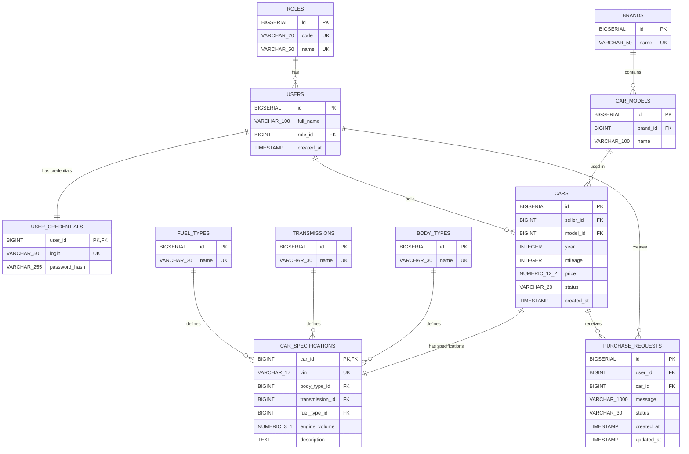

# Маркетплейс автомобилей с пробегом

Учебное JavaFX-приложение (КР №2) на основе консольной КР №1. Работа ведётся в `main`. Сдача КР №1 зафиксирована тегом `kr1-final`.

Приложение показывает заявки, автомобили и пользователей из PostgreSQL, позволяет добавлять, изменять и удалять записи, искать и фильтровать данные, смотреть связи, статистику и выгружать текущую таблицу в CSV или XLSX.

Jackson в `pom.xml` оставлен из эталонного pom преподавателя, в КР №2 не используется.

## Статус КР №2

- [x] Этап 1 — Maven, Java 21, JavaFX
- [x] Этап 2 — JDBC и PostgreSQL
- [x] Этап 3 — главное окно и таблица заявок
- [x] Этап 4 — добавление и редактирование заявки
- [x] Этап 5 — удаление и смена статуса
- [x] Этап 6 — валидация и обработка ошибок
- [x] Этап 7 — вкладка «Автомобили»
- [x] Этап 8 — вкладка «Пользователи»
- [x] Этап 9 — поиск, фильтрация, сортировка
- [x] Этап 10 — связанные данные
- [x] Этап 11 — статистика
- [x] Этап 12 — экспорт CSV и XLSX
- [x] Этап 13 — CSS и доработка интерфейса
- [x] Этап 14 — тесты, README, подготовка к защите

Материалы к защите: `docs/DEFENSE.md`. Ход работы: `docs/KR2_PROGRESS.md`.

## Требования

- Java 21
- Maven 3.9+
- PostgreSQL
- JavaFX 21.0.8 (подключается Maven-плагином)
- Docker — только если нужно запустить учебную систему из архива преподавателя (PostgreSQL и backend). Само JavaFX-приложение в Docker не запускается.

## Как развернуть базу

1. Создай базу `auto_sale` в PostgreSQL.
2. При необходимости выполни `database.sql` в DBeaver или `psql`.

**Внимание:** скрипт начинается с `DROP TABLE ... CASCADE` и удаляет существующие таблицы вместе с данными. Не запускай его на заполненной базе без необходимости.

3. Скопируй `src/main/resources/database.properties.example` в `src/main/resources/database.properties` и укажи пароль. Файл с паролем в git не попадает.

```properties
db.url=jdbc:postgresql://localhost:5432/auto_sale
db.user=postgres
db.password=...
```

Параметры можно переопределить переменными окружения: `DB_URL`, `DB_USER`, `DB_PASSWORD`.

Тестовые логины из seed-данных: `admin` / `admin123` (ADMIN), `ivan`, `petr`, `alex`, `dmitry` (пароль `12345`). В КР №2 окна входа нет: все вкладки доступны сразу.

## Запуск JavaFX

```bash
mvn clean compile
mvn javafx:run
```

Главный класс: `carmarket.fx.CarMarketApplication`. Тонкий запуск из `carmarket.Main` тоже вызывает `Application.launch`.

Если PostgreSQL не запущен или `database.properties` неверный, окно открывается и показывает понятное сообщение. Подробности пишутся в лог slf4j.

## Тесты

```bash
mvn test
```

Тесты сервисов, экспорта и FXML работают без базы. Интеграционные `RepositoryTest` и `CrudRepositoryTest` пропускаются, если PostgreSQL недоступен.

## Архитектура

```
FXML / Controller
        ↓
     Service
        ↓
    Repository
        ↓
   JDBC (PreparedStatement)
        ↓
     PostgreSQL
```

- Controller получает действие пользователя, вызывает Service и обновляет `ObservableList` / подписи.
- Service проверяет бизнес-правила и валидирует ввод.
- Repository содержит SQL и JDBC.
- Параметры БД читает `DatabaseManager` из `database.properties`.

## Структура пакетов

```
src/main/java/carmarket/
    Main.java
    fx/              CarMarketApplication
    controller/      окна и диалоги JavaFX
    model/           User, Car, PurchaseRequest и вспомогательные строки
    enums/
    repository/
    service/
    interfaces/
    exception/
    util/            DatabaseManager, AlertHelper, DialogHelper, экспорт
src/main/resources/
    fxml/
    css/style.css
    database.properties.example
legacy-console/carmarket/ui/   консоль КР №1, Maven её не компилирует
```

## Учебная система из архива (Docker)

Это не замена нашему JavaFX-клиенту. Архив преподавателя обычно поднимает PostgreSQL и backend.

Пример запуска из архива:

```bash
docker compose --env-file .env -f backend/docker-compose.yml up -d --wait
```

Проверка:

- http://localhost:8080/
- http://localhost:8080/actuator/health

Остановка без удаления volume — `docker compose ... stop` / `down` без `-v`.

JavaFX в Docker не запускаем: нужен графический интерфейс локальной машины. Наш клиент ходит в PostgreSQL КР №1 напрямую по JDBC, без REST.

## Основные возможности

- вкладки «Заявки», «Автомобили», «Пользователи», «Статистика»
- добавление, изменение, удаление с подтверждением
- смена статуса заявки только по допустимым переходам
- поиск, фильтры и сортировка заявок; поиск и сортировка автомобилей
- подробности заявки и связанные списки
- не менее пяти показателей статистики
- экспорт видимых строк таблицы в `.csv` или `.xlsx` через FileChooser

## Бизнес-правила

1. Нельзя создать заявку на несуществующий автомобиль или от несуществующего пользователя.
2. Нельзя создать заявку на автомобиль со статусом `SOLD` или `ARCHIVED`.
3. У пользователя не больше одной активной заявки (`NEW`, `IN_PROGRESS`) на один автомобиль.
4. Цена автомобиля > 0, пробег >= 0.
5. Переходы заявки: `NEW → IN_PROGRESS`, `NEW → CANCELLED`, `IN_PROGRESS → APPROVED`, `IN_PROGRESS → REJECTED`, `IN_PROGRESS → CANCELLED`. Из `APPROVED` / `REJECTED` / `CANCELLED` переходов нет.

Пароль пользователя хранится так же, как в КР №1: в `user_credentials.password_hash` без отдельного нового алгоритма хеширования. Пароль в таблицах и экспорте не показывается.

## Структура базы

Актуальная схема — в `database.sql`. Основные таблицы: `roles`, `users`, `user_credentials`, `brands`, `car_models`, `body_types`, `transmissions`, `fuel_types`, `cars`, `car_specifications`, `purchase_requests`.

Логин и пароль не лежат в `users`. Марка, VIN и характеристики не лежат в `cars`.



Связи:

```
ROLES 1:N USERS
USERS 1:1 USER_CREDENTIALS
BRANDS 1:N CAR_MODELS
CAR_MODELS 1:N CARS
USERS 1:N CARS
CARS 1:1 CAR_SPECIFICATIONS
USERS 1:N PURCHASE_REQUESTS
CARS 1:N PURCHASE_REQUESTS
```
